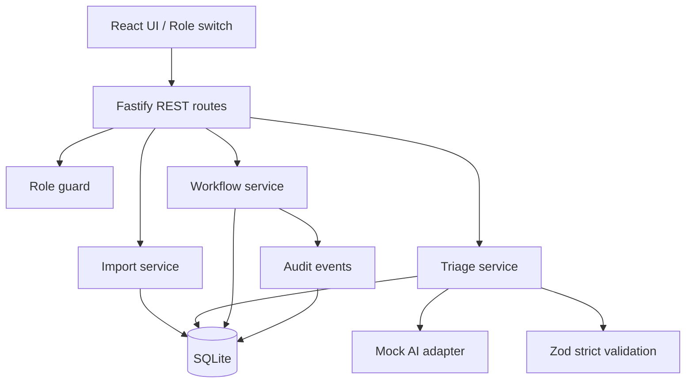
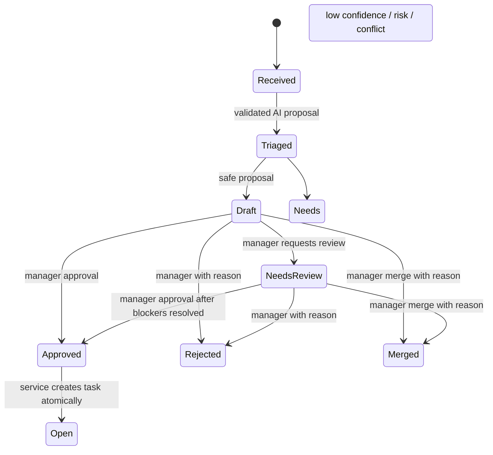

# AI Triage Console — Architecture

> Candidate-authored architecture based on the Delements assessment and synthetic fixtures. No production data; implemented behavior and local-demo limitations are documented below.

## Stack and runtime
- React + Vite UI; Fastify REST server; SQLite (persistent local file); Zod schemas; Vitest + Fastify inject.
- The root npm workspace provides `npm install`, `npm run dev`, `npm test`, and `npm run build`. Health, SQLite schema, Manager-only import/triage/decisions, fixture relation seeding, filtered request list/detail reads, audit history, task listing, and a minimal React console are implemented.
- `npm run dev` starts the API and UI locally. The default SQLite file is `.data/assessment.sqlite`; `DATABASE_PATH` may override it. Tests use isolated in-memory databases.
- No paid AI account or network calls. Mock adapter is the default and required path.

## Component boundaries

## Database schema (logical)
- `requests(id TEXT PRIMARY KEY, source TEXT, department_hint TEXT, requester_role TEXT, submitted_at TEXT, content TEXT, imported_at TEXT)` — source is immutable after initial import. On ID collision, exact matching content is a no-op; differing content is a 409 conflict and never silently overwritten.
- `proposals(id INTEGER PRIMARY KEY, request_id TEXT UNIQUE REFERENCES requests(id), department TEXT, priority TEXT, confidence REAL, summary TEXT, proposed_owner TEXT, proposed_steps_json TEXT, risk_flags_json TEXT, recommended_state TEXT, validation_version TEXT, created_at TEXT, updated_at TEXT)` — only validated proposal output stored.
- `request_workflows(request_id TEXT PRIMARY KEY REFERENCES requests(id), state TEXT, version INTEGER DEFAULT 0, updated_at TEXT)` — current state and optimistic version.
- `request_relations(id INTEGER PRIMARY KEY, from_request_id TEXT, to_request_id TEXT, relation_type TEXT, status TEXT, reason TEXT, created_at TEXT, resolved_at TEXT, UNIQUE(from_request_id,to_request_id,relation_type))` — types `duplicate_candidate`, `conflict`, `merged_into`; keep all original request rows. Conflict relation can be represented once using canonical sorted IDs.
- `tasks(id INTEGER PRIMARY KEY, request_id TEXT UNIQUE REFERENCES requests(id), status TEXT CHECK(status='Open'), opened_at TEXT, opened_by TEXT)` — created only after approved workflow transition.
- `audit_logs(id INTEGER PRIMARY KEY, request_id TEXT, actor_role TEXT, action TEXT, from_state TEXT, to_state TEXT, reason TEXT, details_json TEXT, created_at TEXT)` — append-only at application layer. Audit records can also cover failed triage and denied mutation attempts; no secrets or PII.
- `triage_attempts(id INTEGER PRIMARY KEY, request_id TEXT, outcome TEXT, error_code TEXT, created_at TEXT)` — track invalid output/timeout/unavailable without saving invalid proposal.

Use foreign keys, indexes on workflow state and audit request/time, and SQLite transactions for state+audit+task/relations.

The current SQLite bootstrap creates these tables as `STRICT` tables, enables
foreign keys, and adds the listed indexes. Baseline import persists each valid
source row and an initial `Received` workflow in the same transaction. After a
successful import, it idempotently seeds the S1 duplicate candidate and
canonical S2 conflict relation from validated scenario metadata.

## State machine

- The workflow state is authoritative; `recommended_state` is only an AI suggestion and must be `Draft` or `Needs Review`.
- If triage fails validation or times out, leave the request at `Received` and log a failed attempt; allow explicit retry.
- The implemented mock adapter strictly validates each proposal, stores only validated output, and applies the routing threshold/risk/conflict policy. Fault injection is disabled when `NODE_ENV=production`.
- The implemented decision service rechecks Manager authorization, checks `expected_version`, and commits decisions with audit/relations/tasks atomically. Approval increments the version once and records its Approved/Open audit transitions; conflict resolution increments both related workflow versions but leaves both in `Needs Review`.
- An unresolved duplicate-candidate or conflict relation blocks approval. Manager merge preserves both source requests, marks only the source Merged, resolves the duplicate relation, and records the `merged_into` edge; self-merge, cycles, and terminal targets are rejected.
- `Approved` is a short-lived explicit transition recorded in audit; creation of Open task and transition to `Open` happen in the same DB transaction.
- `Rejected` and `Merged` are terminal. Reimport never resets workflow or deletes tasks.
- Any mutation requires server-side Manager authorization. Role switch is assessment-only, not secure authentication.

## Safety gates
1. Strict AI schema: department enum `IT, Marketing, E-commerce, Customer Service, SCM, Finance, HR, Production, Needs Review`; priority `Critical, High, Medium, Low`; confidence 0..1; summary 1..240 chars; nonempty owner; nonempty bounded steps each with `action` and `done_when`; risk flags from `duplicate, conflict, security, privacy, missing-information`; recommended state only `Draft` or `Needs Review`.
2. Routing policy overrides AI recommendation: confidence < 0.70 OR any risk flag OR unresolved conflict => `Needs Review`. Confidence 0.70 is candidate assumption.
3. Conflict gate: both REQ-003/004 stay Needs Review until a Manager records a resolution reason; a resolution must not automatically approve either request. Manager can then approve individually. A reason alone does not imply security authorization in production.
4. Duplicate: REQ-002 candidate references REQ-001. Manager merges REQ-002 into REQ-001 with reason. REQ-002 state `Merged`; REQ-001 stays in its prior state; neither original row is deleted. Prevent self-merge, cycles, and merging into terminal request.
5. Clarification: Manager records `clarification_requested` audit for REQ-005; it stays Needs Review. New information would require explicit amendment/re-triage, out of scope for the initial MVP.
6. Security/privacy: REQ-006 requires an authorized team/role proposal and Manager review; no customer data in fixture.
7. Prompt injection: REQ-007 is plain untrusted text; mock response is validated; never interpret request content as privileged commands. Render text as escaped text, never `dangerouslySetInnerHTML`.
8. Service errors: malformed/timeout/unavailable => triage_attempt failure + audit, no invalid proposal and no Open task. Do not use provider credentials.
9. Optimistic concurrency: require workflow version for decisions; reject stale version with 409. Atomic audit + state change prevents partial decisions.

## Deterministic fixture strategy
- CSV contains exactly 12 source rows REQ-001..REQ-012. `mock-ai-responses.json` holds default responses keyed by ID, scenario metadata, and fault injections. Metadata is test configuration, not model output or authorization.
- Use explicit fixture relationships for S1/S2 to guarantee evaluator reproducibility; a future similarity detector is optional and not claimed.
- Import twice must leave 12 unique rows and preserve prior decisions.

## Trade-offs / limitations
- Mock role header or local role switch is not authentication; production requires verified identity and authorization.
- SQLite is sufficient for a single local reviewer; production might need Postgres, migrations, observability and concurrency/load tests.
- Fixed fixture mapping is deterministic, not general-purpose semantic duplicate detection.
- No third-party integrations, live LLM, deployment, or background agents.
- Reviewer access is not required before submission per recruiter clarification; handoff permissions should be agreed at submission.
